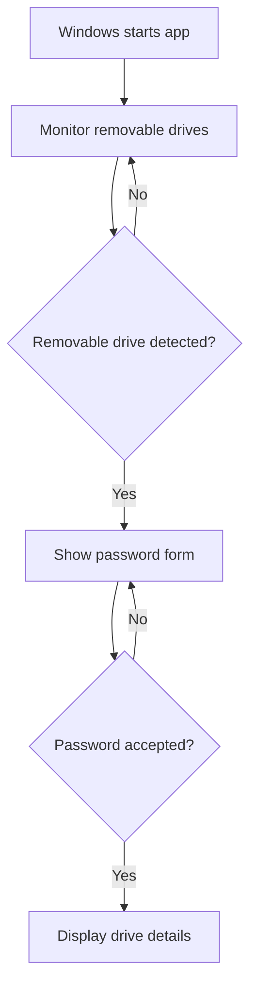

# USB Authentication System — Windows Prototype

A Python/Flask desktop-oriented prototype that detects removable drives on Windows, displays drive information, and gates the details page behind a password check.

> **Important limitation:** the current code detects removable drives, but it does not compare a detected drive against an authorized serial-number allowlist. Do not describe it as serial-number-based authentication until that validation is implemented and tested.

## Features present in the current code

- Removable-drive detection through Windows APIs and WMI
- Background monitoring with a polling fallback
- Password-gated details page using a Flask session
- Display of volume name, volume serial, filesystem, capacity, free space, and top-level files
- Logging of monitoring and drive-inspection events

## Detection flow

This represents the current prototype behavior, not a verified device-identity security boundary.

## Technology

- Python
- Flask
- pywin32 / Windows API
- WMI
- pythoncom

## Platform requirements

This project is Windows-specific. The repository currently contains `app.py` and this README, but the code references `templates/index.html` and `templates/details.html`, which are not tracked in the current repository tree. Those templates must be added before the UI can run. A dependency manifest and clean setup instructions are also missing.

## Security work required before a live demo

- Remove the hardcoded password and load credentials securely.
- Do not run Flask debug mode or expose the development server on a public network.
- Implement and test an explicit authorized-device allowlist if device authorization is the goal.
- Avoid exposing directory contents or sensitive drive details to unauthorized users.
- Store logs in a configurable, writable application-data directory.
- Add the missing templates and test the app on a clean Windows machine.

## Screenshots and demo

Screenshots and a live demo are not included yet. Add genuine screenshots of the waiting state, detected-device state, authentication form, and details page after the missing templates and security changes are completed.

## Author

Harish T · Python Backend Developer

Repository: https://github.com/Hari24022002/USB-authentication-system
